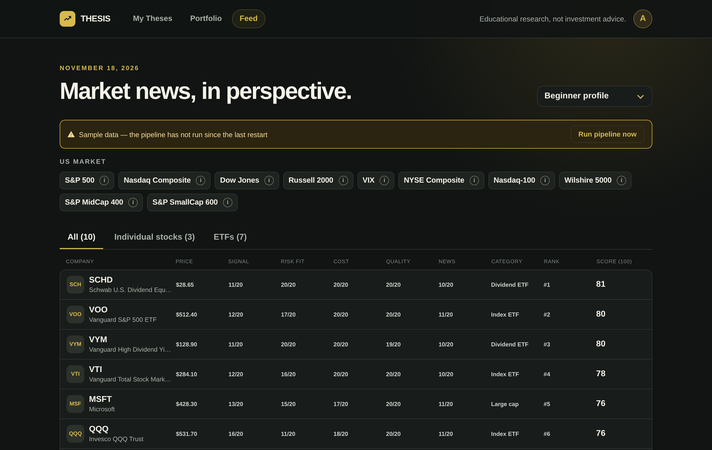
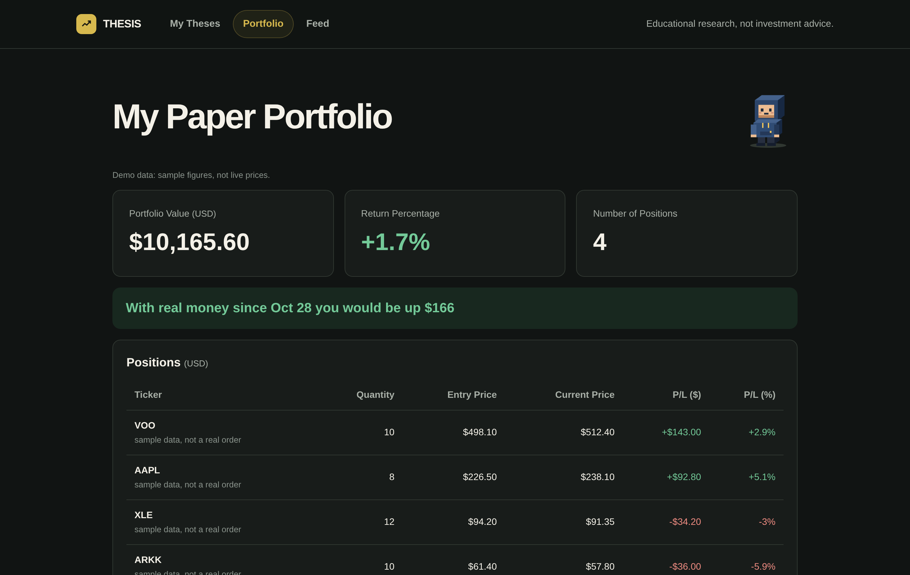
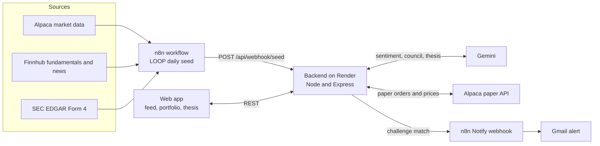
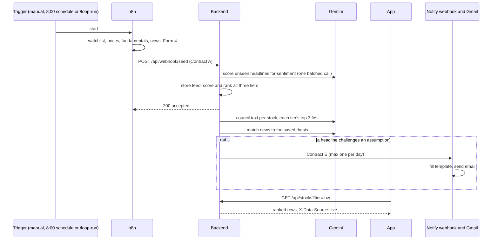

# THESIS

**Read the news behind every pick: daily research for first-time investors.**


THESIS (formerly TFSA Gold, codename LOOP) is a daily, personalized research feed for Canadian beginner investors. Each day it ranks the top 10 stocks and ETFs for three risk tiers, explains every pick with a bull case, a bear case and a plain-language overall read, and watches the news against the goal a user wrote down. It presents candidates to research. It never tells anyone to buy or sell.

Built at the LOOP Buildathon (n8n track), November 14 to 15, 2026.

## Why THESIS

First-time investors get two kinds of help: hype that says what to buy, or spreadsheets that say nothing about whether a pick fits their situation. Neither shows the reasoning, and neither notices when the news changes the case for something they already hold.

THESIS shows its work. Every score is built from five visible parts, every pick comes with the strongest argument for and against it, and the user's own assumptions are checked against the day's headlines. When a headline challenges an assumption, the user gets an email. Nothing is hidden behind a black box, and every number on screen says where it came from.

## Demo

| | |
|---|---|
| Live app | TODO: add the live app URL |
| Demo video | TODO: add the demo video URL |

### Screenshots

<!-- TODO: add real screenshots to docs/assets/ and uncomment. Do not commit placeholder images.





-->

TODO: screenshots of the feed, the detail drawer, the portfolio, the thesis page and the alert email.

## What it does

- **Daily feed.** Top 10 or fewer per tier (Beginner, Intermediate, Advanced), never padded. Tiers map to `low`, `medium` and `high` in the API. A combined "All" view ranks stocks and ETFs together, with filters for each.
- **Transparent scoring.** A deterministic 0 to 100 match score from five parts: signal, risk fit, cost, quality and news. No LLM touches the ranking.
- **AI council.** Gemini writes a bull case, a bear case and an "Overall read" for each pick. The council explains. It never decides rank.
- **Paper trading.** Practice buys through the Alpaca paper API, with a portfolio view and a plain-words note whenever a fill was estimated or simulated.
- **Thesis alerts.** A user states a goal in plain text. The app extracts two or three assumptions, matches the day's news against them, and sends one email per day when a headline challenges an assumption.
- **Honest data labels.** Every response says whether it is live or sample data, and the UI shows a banner when it is falling back to fixtures.

## How it works

### Architecture



### One daily run



## The n8n pipeline

The workflow is "LOOP daily seed". Code node sources live in `n8n/code/`, and `node scripts/build-n8n-workflow.js` regenerates the importable `n8n/loop-daily.workflow.json`. The watchlist comes from `scripts/universe.js` (60 instruments).

| Stage | Nodes | Produces |
|---|---|---|
| 1. Watchlist | Universe | The 60 instruments with category and, for ETFs, expense ratio |
| 2. Prices | Alpaca stock bars, Alpaca crypto bars | Last price, 5-day change and average volume |
| 3. Fundamentals and news | Stock tickers, Finnhub metric, Finnhub news | Beta, P/E, market cap, dividend yield and recent headlines with summaries |
| 4. Insider filings | SEC tickers, EDGAR targets, SEC submissions, Pick Form 4, SEC Form 4 XML | Open-market insider purchases (Form 4 code P) in the last 30 days |
| 5. Assemble and deliver | Build Contract A, POST /api/webhook/seed | One Contract A payload sent to the backend with the shared secret |
| 6. Thesis alert | Notify Webhook, Fill email template, Send Gmail | An HTML alert email when the backend reports a challenging match |

Triggers: a manual trigger, a daily schedule at 8:00 (shipped disabled in the repo export until the freeze), and a `/loop-run` webhook used by the app's "Run pipeline now" button. The live workflow has 19 working nodes. The repo export has the manual trigger and the schedule but not yet the `/loop-run` webhook trigger, so re-export from n8n before relying on it.

## Scoring

Implemented in `server/scoring.js`. It is pure and deterministic: no LLM calls, no clock, no randomness.

```
matchScore = signal + riskFit + cost + quality + news          (each part is an integer 0 to 20)
part       = round( 20 * min(1, calibrated(raw) * tierWeight) )
```

`calibrated` stretches each raw score's realistic range onto 0 to 1 so the full scale gets used. Ties break by ticker so input order never changes the result. A row whose risk fit rounds to zero is ineligible for that tier.

| Part | What it measures |
|---|---|
| Signal | Stocks and REITs: half insider buying, half 5-day momentum. ETFs and crypto: momentum, reduced when dollar volume is thin |
| Risk fit | How close beta is to the tier's target beta (0.75 beginner, 1.10 intermediate, 1.80 advanced) |
| Cost | ETF expense ratio, or stock P/E, minus a drag for the 15% US dividend withholding in a TFSA |
| Quality | Market cap for stocks, category robustness for funds, plus a small income bonus |
| News | Mean headline sentiment, shrunk toward neutral when there are few headlines |

Tier weights (multipliers applied before the cap at 20):

| Tier | Signal | Risk fit | Cost | Quality | News |
|---|---|---|---|---|---|
| Beginner (`low`) | 0.90 | 1.25 | 1.20 | 1.10 | 0.95 |
| Intermediate (`medium`) | 1.00 | 1.10 | 1.00 | 1.00 | 1.00 |
| Advanced (`high`) | 1.30 | 1.00 | 1.00 | 1.00 | 1.25 |

Eligibility comes from category and tier, and the beginner tier adds a beta cap of 1.1 for large caps. Missing data is handled neutrally: no 5-day change counts as neutral momentum, and no volume skips the liquidity check. Nothing is invented.

News sentiment is scored in the backend (`server/sentiment.js`), not in n8n. One batched Gemini call rates every unseen headline from -1 to 1 before the feed is stored, and scores are cached for 7 days.

## Guardrails

- **Advice filter.** `server/council.js` drops any council sentence that reads as advice. `recommend`, `should` and `must` always match. `buy` and `sell` match only in instruction forms ("buy it", "consider buying", "you can sell", "a strong buy"), so descriptive uses such as "insider buying" and "the buy side" survive. If a sentence is removed, the parts that remain are still shown, and the UI hides only the empty part.
- **Candidates, not recommendations.** The wording across the app is "candidates" and "matches". The line "Educational research, not investment advice." appears in the header and footer of every page.
- **Paper money only.** Trades go to the Alpaca paper API. The portfolio starts from a notional 10,000 USD.
- **Data-source labelling.** `GET /api/stocks` and `GET /api/paper/portfolio` set an `X-Data-Source: live | fixture` header. The feed page shows a provenance bar: "Live data" with the pipeline run time in the viewer's timezone, or an amber "Sample data" warning when the backend is serving fixtures.
- **No fabricated content.** Missing values stay null. The council text is null when it has not run, and the UI omits what is missing.
- **MER is never displayed as a number.** It only feeds the cost score. Expense ratios in `scripts/universe.js` are hand-entered and marked unverified.

## API reference

The backend is Node and Express (`server/index.js`). Static pages are served from `public/`.

| Method and path | Purpose | Auth |
|---|---|---|
| `GET /api/health` | Status, config flags, feed run date, sentiment check | none |
| `POST /api/webhook/seed` | Receive the n8n payload (Contract A) | `x-webhook-secret` |
| `GET /api/stocks?tier=low\|medium\|high` | Ranked feed for a tier (Contract B) | none |
| `POST /api/thesis` | Create and save a thesis from `{ goalsText }` (Contract C) | none |
| `GET /api/thesis` | The saved thesis, or 404 | none |
| `GET /api/thesis/news` | News matches for the saved thesis | none |
| `POST /api/paper/buy` | Place a paper buy (Contract D) | none |
| `GET /api/paper/portfolio` | Positions, trades and returns (Contract D) | none |
| `POST /api/admin/run-pipeline` | Ask n8n to start a run, returns 202 | `x-webhook-secret` |
| `POST /api/admin/reset-notify` | Clear the "email already sent today" flag | `x-webhook-secret` |

`GET /api/health` returns `ok`, `llmConfigured`, `alpacaConfigured`, `thesisIsStub`, `feedRunDate`, `feedReceivedAt` and `sentimentMissing`. The last three are null until a seed arrives.

`POST /api/thesis` also accepts `{ "session": ... }` for a confirmed onboarding session (it saves what `getConfirmedThesis` returns, or answers 409 if the session is not confirmed). The web app uses the `goalsText` route.

### Contract A: n8n to backend

`POST /api/webhook/seed`, header `x-webhook-secret`. n8n sends raw metrics only, and the backend does all scoring. Missing values are `null`.

```json
{
  "runDate": "2026-11-15",
  "stocks": [
    {
      "ticker": "VOO",
      "companyName": "Vanguard S&P 500 ETF",
      "category": "index_etf",
      "price": 512.4,
      "beta": 1.0,
      "dividendYieldPct": 1.3,
      "priceChange5dPct": 3.2,
      "avgVolume": 48200000,
      "usListed": true,
      "merPct": 0.03,
      "peRatio": null,
      "marketCapB": null,
      "insider": { "count": 0, "execBuyer": false, "totalUsd": 0 },
      "news": [
        { "headline": "Fed holds rates steady", "summary": "Optional article summary", "source": "Reuters", "url": "https://example.com", "sentiment": null, "datetime": "2026-11-15T13:00:00Z" }
      ]
    }
  ]
}
```

Response: `{ "ok": true, "runDate", "accepted", "rejected", "sentiment": { "scored", "cached", "failed" } }`. Categories: `index_etf`, `bond_etf`, `dividend_etf`, `sector_etf`, `reit`, `large_cap`, `mid_cap`, `small_cap`, `thematic_etf`, `crypto`.

### Contract B: the feed

`GET /api/stocks?tier=low`, sorted by rank. The five breakdown parts sum to `matchScore`. `bullCase`, `bearCase` and `verdict` can be null.

```json
[
  {
    "id": "ad0c37",
    "rank": 1,
    "ticker": "SCHD",
    "companyName": "Schwab U.S. Dividend Equity ETF",
    "category": "dividend_etf",
    "tier": "low",
    "matchScore": 81,
    "scoreBreakdown": { "signal": 11, "riskFit": 20, "cost": 20, "quality": 20, "news": 10 },
    "why": "Volatility is a close fit for this risk level",
    "price": 28.65,
    "bullCase": "two to four sentences",
    "bearCase": "two to four sentences",
    "verdict": "the council's overall read",
    "newsTags": [ { "headline": "Dividend stocks draw inflows as rates level off", "stance": "supports", "url": "https://example.com" } ],
    "updatedAt": "2026-11-15T14:05:00Z"
  }
]
```

`stance` is `supports`, `challenges` or `neutral`. With a saved thesis it comes from news matching against the thesis assumptions. Without one it is derived from the headline sentiment score.

### Contract C: thesis

`POST /api/thesis` with `{ "goalsText": "I can put in $20 every two weeks for 10 years and want steady growth" }`:

```json
{
  "id": "t1",
  "goal": "Long-term growth with small recurring deposits",
  "budget": { "amount": 20, "cadence": "biweekly" },
  "horizonYears": 10,
  "tier": "low",
  "assumptions": ["Broad index funds beat stock picking at this budget", "Low fees compound more than hot picks over 10 years"],
  "createdAt": "2026-11-15T14:00:00Z"
}
```

Facts such as amount, cadence and years are parsed from the text and never invented: anything not stated is `0` or `one_time`. `GET /api/thesis/news` returns matches like:

```json
{ "ticker": "VOO", "headline": "Fed holds rates steady", "url": "https://example.com", "assumptionIndex": 0, "stance": "supports", "whyItMatters": "One sentence" }
```

### Contract D: paper trading

`POST /api/paper/buy` with `{ "ticker": "VOO", "amountUsd": 500 }`:

```json
{ "orderId": "...", "ticker": "VOO", "qty": 0.98, "entryPrice": 512.4, "filledAt": "2026-11-15T14:30:00Z", "fillNote": null }
```

`fillNote` is `null` for a genuine Alpaca fill. Otherwise it is a plain-words reason, for example `"market closed, simulated at Friday's close ($512.40); order queued at Alpaca"` or `"paper trading offline (no Alpaca keys), simulated fill at the last known price ($512.40)"`.

`GET /api/paper/portfolio` returns:

```json
{
  "startValue": 10000,
  "value": 10165.6,
  "returnPct": 1.7,
  "whatIfLine": "With real money since Oct 28 you would be up $166",
  "positions": [ { "ticker": "VOO", "qty": 10, "entryPrice": 498.1, "currentPrice": 512.4, "plUsd": 143, "plPct": 2.9, "fillNote": null } ],
  "trades": [ { "ticker": "VOO", "side": "buy", "qty": 10, "price": 498.1, "at": "2026-10-28T14:30:00Z", "fillNote": null } ]
}
```

Positions are aggregated per ticker. Trades are newest first. With `DEMO_SEED=true`, the backend seeds four backdated demo trades on boot when the ledger is empty and Alpaca keys exist. They are priced from real daily bars, place no orders, and carry a `fillNote`.

### Contract E: notification email

When a thesis match challenges an assumption, the backend posts to `N8N_NOTIFY_WEBHOOK_URL`, at most once per UTC day. n8n fills the email template and sends it through Gmail.

```json
{
  "to": "user@example.com",
  "ticker": "VOO",
  "headline": "Fed signals rate hikes",
  "stance": "challenges",
  "whyItMatters": "One sentence from the news match",
  "thesisGoal": "Long-term growth with small recurring deposits",
  "link": "https://your-app.onrender.com/#thesis"
}
```

The demo has one user, so the recipient comes from `NOTIFY_TO_EMAIL`.

## The thesis engine

`server/thesis.js` is in this repo and is wired into the server. It provides:

- `createThesis(goalsText)`: rule-based extraction of facts from the text, plus one Gemini call for the goal and two or three short assumptions, with a plain fallback if the call fails.
- `matchNews(thesis, newsItems)`: Gemini compares each headline with the user's own assumptions and returns a stance and a one-sentence reason. A non-neutral stance needs an article summary of at least 40 characters, which is why summaries travel from Finnhub through the seed.
- Onboarding functions (`onboardingTurn`, draft creation, assumption review, `getConfirmedThesis`) are implemented and tested, and `POST /api/thesis` can save a confirmed session. The current web UI creates a thesis from free text and does not drive the onboarding conversation.

Prompts live in `prompts/thesis.md`.

## Getting started

### Prerequisites

- Node 18 or newer
- Optional keys: Gemini (`GEMINI_API_KEY`), Alpaca paper keys, a Finnhub key for the local seed script. The server runs without them and degrades: no LLM key means null council text and null sentiment, and no Alpaca keys means simulated paper fills and fixture portfolio data.

### Install and run

```bash
npm install
cp .env.example .env     # then fill in values; .env is gitignored
npm start                # http://localhost:3000
```

Dependencies are `express`, `cors` and `dotenv`.

### Environment variables

Names only. Never commit values.

| Name | Purpose | Used in |
|---|---|---|
| `GEMINI_API_KEY` | Gemini access for sentiment, council and thesis | `server/llm.js` |
| `GEMINI_BASE_URL` | Gemini OpenAI-compatible endpoint (has a default) | `server/llm.js` |
| `GEMINI_MODEL` | Primary model | `server/llm.js` |
| `FALLBACK_GEMINI_MODEL` | Model to retry once on a 404 or retired model | `server/llm.js` |
| `COUNCIL_MODE` | `mini` (default), `lite` or `full` | `server/council.js` |
| `ALPACA_KEY_ID`, `ALPACA_SECRET_KEY` | Alpaca paper keys | `server/alpaca.js`, `scripts/build-seed-from-live.js` |
| `ALPACA_PAPER_URL`, `ALPACA_DATA_URL` | Optional endpoint overrides (used by tests) | `server/alpaca.js` |
| `FINNHUB_KEY` | Finnhub key for the local seed script only | `scripts/build-seed-from-live.js` |
| `FINNHUB_BASE_URL` | Optional override for that script | `scripts/build-seed-from-live.js` |
| `INBOUND_WEBHOOK_SECRET` | Shared secret for the seed and admin endpoints | `server/index.js` |
| `N8N_NOTIFY_WEBHOOK_URL` | n8n Notify Webhook production URL (Contract E) | `server/notify.js` |
| `N8N_RUN_WEBHOOK_URL` | n8n run webhook, used by `POST /api/admin/run-pipeline` | `server/index.js` |
| `NOTIFY_TO_EMAIL` | Alert recipient for the single demo user | `server/notify.js` |
| `PUBLIC_URL` | Base URL for the link in the alert email | `server/notify.js`, `scripts/preflight.js` |
| `RENDER_EXTERNAL_URL` | Set by Render, used if `PUBLIC_URL` is unset | `server/notify.js` |
| `DEMO_SEED` | `true` seeds four backdated demo trades on boot | `server/paper.js` |
| `LOOP_DB_FILE` | Path of the JSON store (default `data/db.json`) | `server/store.js` |
| `LLM_MIN_GAP_MS` | Gap between LLM calls, default 5000 ms; for tests | `server/llm.js` |
| `PORT` | HTTP port, default 3000 | `server/index.js` |

### Tests

```bash
npm test                 # every suite, offline, no keys needed
npm run test:council     # the council and advice filter
npm run test:scoring
npm run test:endpoints
```

Other scripts in `package.json`: `test:n8n`, `test:sentiment`, `test:paper`, `test:onboarding`, `test:draft`, `test:llm`, `test:news`, `demo:onboarding`, `demo:news` and `preflight`.

### Seed the feed locally

Without n8n you can build a seed from live market data and post it yourself. This needs Alpaca keys and, optionally, a Finnhub key in `.env`. Insider data is zeros in this path because Form 4 parsing lives in n8n.

```bash
node scripts/build-seed-from-live.js --out /tmp/seed.json
curl -X POST http://localhost:3000/api/webhook/seed \
  -H "content-type: application/json" \
  -H "x-webhook-secret: $INBOUND_WEBHOOK_SECRET" \
  --data-binary @/tmp/seed.json
```

Without keys, the API serves fixtures from `fixtures/` and labels them `X-Data-Source: fixture`.

## Deployment and operations

The app runs on a Render free web service (`npm start`). Set the environment variables above in the Render dashboard. `docs/demo-runbook.md` has the full warm-up and rehearsal sequence.

**Reseed after every deploy or restart.** Render's free-tier disk is ephemeral. Every restart or redeploy wipes `data/db.json`, which holds the feed, the saved thesis, the paper ledger and the notify date. Until n8n seeds again, `/api/stocks` serves fixtures and the app shows the "Sample data" banner. The free tier also sleeps when idle, so the first request after a pause is a cold start.

Plan for roughly 9 minutes end to end from a deploy to a fully populated feed: about 2.5 minutes for the n8n run, then the council fills in, with each tier's top 3 first. Council calls are serialized with a 5 second gap, so the full set takes a few more minutes.

To reseed, run the workflow in n8n with the manual trigger, or use "Run pipeline now" in the app if `N8N_RUN_WEBHOOK_URL` is set.

To confirm a live seed:

```bash
curl -s https://<your-app>.onrender.com/api/health
curl -s -D - -o /dev/null "https://<your-app>.onrender.com/api/stocks?tier=low" | grep -i x-data-source
npm run preflight -- https://<your-app>.onrender.com
```

A good state shows `feedRunDate` set, `sentimentMissing` false and `X-Data-Source: live`. In the app, the bar under the header reads "Live data" with the pipeline run time.

n8n credentials, by name: "LOOP Alpaca" (custom auth with two headers), "LOOP Finnhub" (header auth), "LOOP SEC User-Agent" (header auth, must include a contact or SEC returns 403), "LOOP Webhook Secret" (header auth, `x-webhook-secret`), plus Gmail OAuth2.

## Known limitations and roadmap

- **No persistence on Render.** The feed, thesis and ledger live in a JSON file on an ephemeral disk, so they are lost on every deploy. A real database is not part of this build.
- **Unauthenticated n8n webhooks.** The Notify webhook has no secret. This was an accepted risk for the demo: the recipient is one fixed inbox. The `/loop-run` webhook should be treated the same way until it is secured.
- **Single user, no accounts.** The thesis and the paper ledger are global to the deployment. The public thesis and paper endpoints have no auth.
- **Finnhub metrics keyed by position.** The Build Contract A node pairs Finnhub metric responses with tickers by order. A skipped or failed call could misalign them. Keying by ticker is the fix.
- **Insider data covers stocks only.** ETFs have none by design, and EDGAR coverage depends on the SEC ticker map.
- **Expense ratios are hand-entered.** They are marked unverified in `scripts/universe.js`. Spot-check any ETF that reaches a top 10.
- **Free-tier LLM limits.** Council and sentiment calls are serialized and throttled, and a model retirement falls back once to a second model, then to null text.
- **US-listed universe.** Sixty instruments, all US-listed. Canadian-listed securities are future work.
- **No TFSA contribution tracking.** Contribution room and limits are future work. The scorer only accounts for US dividend withholding.
- **Gmail node.** The repo export sets the Gmail node's `emailType` to `html`. Re-check it after importing into n8n.

## Team and acknowledgements

| Who | Role |
|---|---|
| Taha Saiyed | Backend, n8n workflow, data, deploy |
| Vamsi | Thesis engine (`server/thesis.js`, `prompts/thesis.md`) |
| Anne | Feed UI |
| Dianne | Portfolio and thesis pages, email template, deck |

The council design is adapted from `aiwithremy/claude-skills-llm-council`, whose methodology is based on Andrej Karpathy's LLM Council, with the skill authored by Ole Lehmann. Market data comes from Alpaca, Finnhub and SEC EDGAR. News sentiment, council text and thesis matching use Gemini.

## Disclaimer

THESIS is an educational research tool. It is not financial, investment, tax or legal advice, and nothing in it is a recommendation to buy or sell any security. Trading in the app is paper trading with practice money only. Past performance and sample data do not predict results. Do your own research and speak to a licensed professional before investing.
