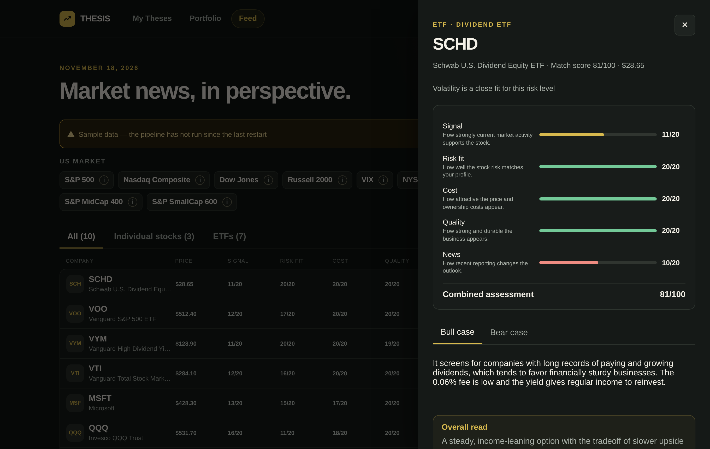
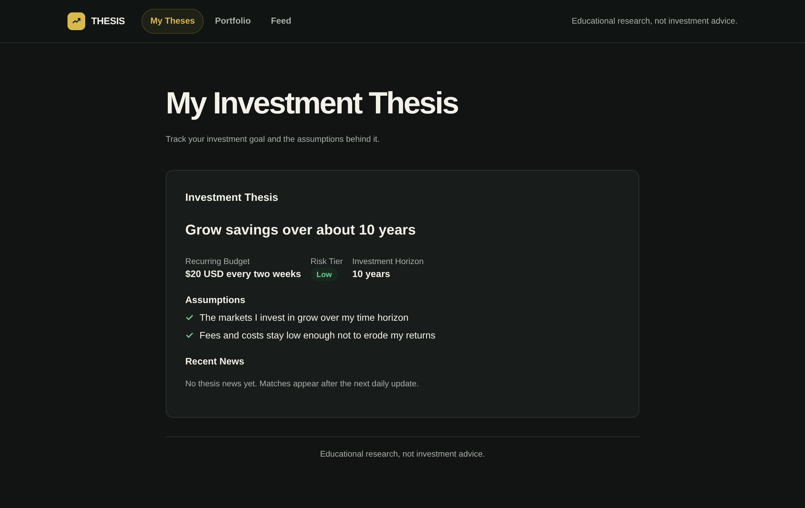
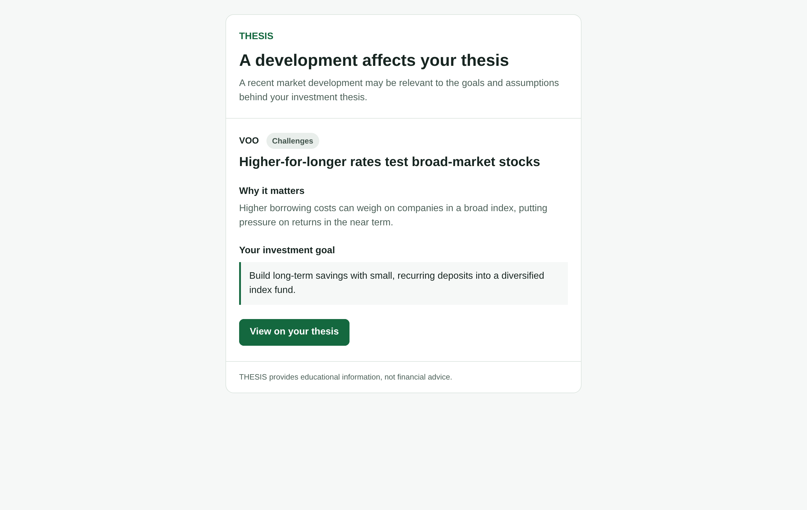
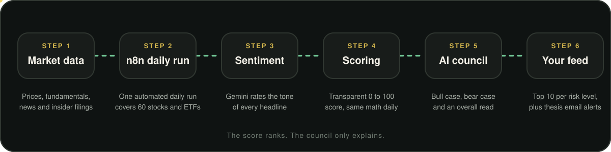
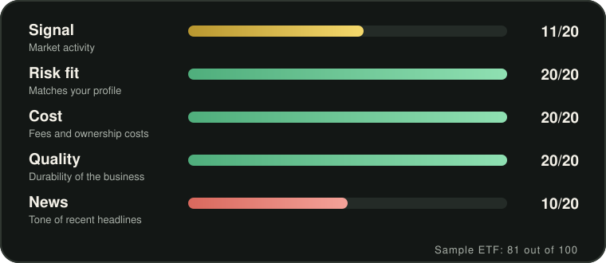

<div align="center">





<br>


**[What it does](#-what-it-does)** &nbsp;·&nbsp; **[See it](#-see-it)** &nbsp;·&nbsp; **[How it is made](#-how-it-is-made)** &nbsp;·&nbsp; **[Install](#-install-and-run)** &nbsp;·&nbsp; **[Team](#-team)**


</div>

## 🏆 Recognition

| | |
|:--|:--|
| 🥇 **1st Prize** | **Investly Roadmap** |
| 🥉 **3rd Place Overall** | **Ant** |

THESIS (formerly TFSA Gold) was built at the LOOP Buildathon, November 14 to 15, 2026, on the n8n track.


## 💡 What it does

First-time investors usually get two kinds of help: hype that says what to buy, or spreadsheets that say nothing about whether a pick fits their life. Neither shows its reasoning, and neither notices when the news changes the story behind something they care about.

**THESIS shows its work.** Every day it ranks the top stocks and ETFs for three risk levels, explains each one with the strongest case for and against it, and watches the headlines against the goal you wrote down. If the news challenges one of your assumptions, it emails you.

<table>
<tr>
<td width="33%" valign="top">

### 📰 Read
A fresh daily feed of **10 or fewer** candidates per level: Beginner, Intermediate and Advanced. Never padded to look fuller than it is.

</td>
<td width="33%" valign="top">

### 🧠 Understand
Every pick comes with a **bull case**, a **bear case** and an **overall read** in plain language, so you see both sides before you decide anything.

</td>
<td width="33%" valign="top">

### 🔔 Stay alert
Write your goal once. THESIS turns it into a few assumptions and **emails you** when a headline challenges one.

</td>
</tr>
</table>

### Everything inside

- **Transparent scoring.** A 0 to 100 match score built from five visible parts. Same math every day, no black box.
- **AI council that explains, never ranks.** Gemini writes the bull case, bear case and overall read. The ranking is decided by the score alone.
- **Paper trading.** Practice with pretend money through Alpaca's paper trading, with a portfolio view and a plain-words note whenever a fill was estimated.
- **Thesis page.** Your goal, your assumptions and the news that matters to them, in one place.
- **Honest data labels.** The app always tells you whether you are looking at live data or sample data.
- **Candidates, not advice.** THESIS never tells anyone to buy or sell, and filters out any sentence that sounds like it.


## 🖼 See it

<table>
<tr>
<td width="50%"><br><sub><b>The daily feed.</b> Ranked candidates with a score broken into five parts.</sub></td>
<td width="50%"><br><sub><b>The detail view.</b> Score breakdown, bull case, bear case and overall read.</sub></td>
</tr>
<tr>
<td width="50%"><br><sub><b>Your thesis.</b> Your goal and the assumptions behind it.</sub></td>
<td width="50%"><br><sub><b>Paper portfolio.</b> Practice investing with no real money at risk.</sub></td>
</tr>
<tr>
<td colspan="2" align="center"><br><sub><b>The alert email.</b> Sent when a headline challenges one of your assumptions.</sub></td>
</tr>
</table>

<sub>Screenshots are taken with the built-in sample data, so the app shows its "Sample data" label.</sub>


## 🛠 How it is made

THESIS is a small pipeline. An automated workflow gathers the day's market data, the backend scores and ranks it, AI explains it, and the website and email deliver it.



| Step | What happens |
|:--|:--|
| **1. Market data** | Prices and trading volume come from Alpaca. Fundamentals and news come from Finnhub. Insider purchases come from SEC EDGAR filings. |
| **2. n8n daily run** | One n8n workflow collects everything for a watchlist of 60 US-listed stocks and ETFs and hands it to the backend. It can run on a schedule, by hand, or from a button in the app. |
| **3. Sentiment** | Gemini reads every new headline in one batch and rates its tone from negative to positive. Scores are remembered for a week. |
| **4. Scoring** | The backend ranks every candidate with a transparent score. No AI is involved in the ranking. |
| **5. AI council** | Gemini explains the top picks with a bull case, a bear case and an overall read, and a filter removes anything that sounds like advice. |
| **6. Your feed** | The website shows the ranked list for your level. If the news challenges your thesis, n8n sends the alert email through Gmail. |

### How a match score is built

Every candidate gets five scores from 0 to 20. They add up to the 0 to 100 match score you see.

<div align="center">

</div>

| Part | The question it answers |
|:--|:--|
| **Signal** | Is there real market activity behind it, such as recent momentum or insiders buying? |
| **Risk fit** | Do its ups and downs match the risk level you picked? |
| **Cost** | Are the fees low and the price sensible, including the tax drag on US dividends in a TFSA? |
| **Quality** | How large, durable and well established is it? |
| **News** | Is the recent reporting positive or negative? |

The three levels weigh these parts differently. Beginner leans on risk fit and cost, Advanced leans on signal and news. When data is missing, THESIS treats it as neutral instead of guessing.

### Built to be honest

- **The score ranks, the council explains.** The AI can never change the order.
- **No instructions to buy or sell.** The wording across the app is "candidates" and "matches". Advice-style sentences are removed before you see them.
- **Paper money only.** Trades go to Alpaca's paper trading with a notional $10,000.
- **Nothing is made up.** If something is missing it stays empty, and the app says so.
- **Clear data labels.** Live data shows when the pipeline last ran. Sample data is clearly marked.

### Built with

| | |
|:--|:--|
| **Automation** | n8n |
| **Backend** | Node.js and Express |
| **AI** | Gemini for sentiment, the council and thesis matching |
| **Market data** | Alpaca, Finnhub, SEC EDGAR |
| **Paper trading** | Alpaca paper trading API |
| **Email** | Gmail through n8n |
| **Website** | Plain HTML, CSS and JavaScript |
| **Hosting** | Render |


## 🚀 Install and run

### Requirements

- **Node.js 18 or newer** (includes npm). Check with `node --version`.
- **Git**, to download the project.
- A modern web browser.

That is all. THESIS runs with no accounts and no API keys. Without them it uses the built-in sample data and clearly labels it.

### Quick start

```bash
git clone https://github.com/TahaSaiyed08/LOOP.git
cd LOOP
npm install
npm start
```

Then open **http://localhost:3000** in your browser. Create a local account, pick a level, describe your goal, and you are in.

### Unlock live features (optional)

Add keys to a `.env` file to turn on the live parts. Each one is independent, so add only what you want.

```bash
cp .env.example .env
```

| Add this key | To get |
|:--|:--|
| `GEMINI_API_KEY` | AI sentiment, the bull and bear cases, and thesis matching |
| `ALPACA_KEY_ID` and `ALPACA_SECRET_KEY` | Real paper-trading orders and live prices ([free paper account](https://alpaca.markets)) |
| `FINNHUB_KEY` | Live news and fundamentals when seeding the feed locally |

### Fill the feed with live data (optional)

With Alpaca keys in `.env`, you can build a live seed from real market data and load it into your running app:

```bash
node scripts/build-seed-from-live.js --out seed.json
curl -X POST http://localhost:3000/api/webhook/seed \
  -H "content-type: application/json" \
  -H "x-webhook-secret: $INBOUND_WEBHOOK_SECRET" \
  --data-binary @seed.json
```

Set `INBOUND_WEBHOOK_SECRET` in `.env` to any value you like first. The automated n8n workflow in `n8n/` does the same job every day, including insider filings and the alert email.

### Run the tests

```bash
npm test
```

Every test runs offline and needs no keys.


## 🧭 What is next

- Persistent storage, so your thesis and paper portfolio survive restarts
- Accounts for more than one user, with a personal alert inbox for each
- Canadian-listed stocks and ETFs
- TFSA contribution room tracking
- Verified fund fee data for every ETF


## 👥 Team

| Who | Role |
|:--|:--|
| **Taha Saiyed** | Backend, n8n workflow, data, deployment |
| **Vamsi** | Thesis engine |
| **Anne** | Feed UI, UI/UX design |
| **Dian Ping** | Frontend development, UI/UX design, paper portfolio and thesis pages, interactive features, email templates, hackathon pitch deck |

### Thanks

The AI council design is adapted from [`aiwithremy/claude-skills-llm-council`](https://github.com/aiwithremy/claude-skills-llm-council), whose method is based on Andrej Karpathy's LLM Council, with the skill authored by Ole Lehmann. Market data comes from Alpaca, Finnhub and SEC EDGAR. Sentiment, council text and thesis matching use Gemini.


<div align="center">

### ⚠️ Disclaimer

THESIS is an educational research tool. It is not financial, investment, tax or legal advice, and nothing in it is a recommendation to buy or sell any security. Trading in the app is paper trading with practice money only. Past performance and sample data do not predict results. Do your own research and speak to a licensed professional before investing.

**Educational research, not investment advice.**

</div>
